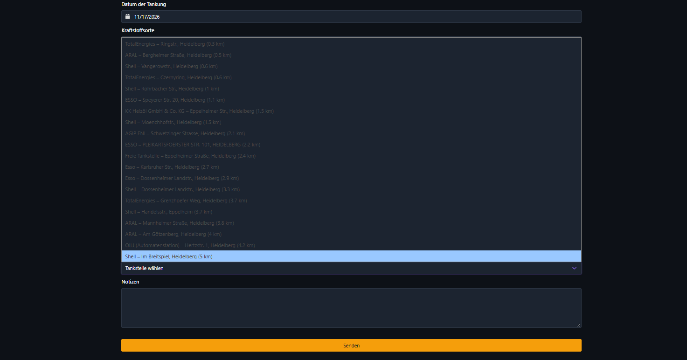

# Hammond Modern 🚗

**Self-Hosted-Fahrzeugverwaltung mit modernisierter Oberfläche, Wartungsplanung und einfacher Datenübernahme aus dem ursprünglichen Hammond.**

Hammond Modern ist ein unabhängiger Community-Fork von [akhilrex/hammond](https://github.com/akhilrex/hammond). Das Projekt ist **nicht offiziell mit dem Originalautor verbunden**.

**Stable-Version: v1.1.9** · Weiterentwicklung im Develop-Branch · [Releases](https://github.com/Skoun181/hammond-modern/releases) · [Änderungsverlauf](CHANGELOG-MODERN.md)

> **Teststand:** Die alltäglichen Funktionen und die Migrationsvorschau wurden auf einer privaten Debian-13-LXC-Installation getestet. Das Docker-Hub-Image wurde außerdem erfolgreich auf einer Synology über Dockhand und macvlan gestartet (Anwenderbestätigung). Der portable ZIP-Export und -Import wurden praktisch getestet (Anwenderbestätigung). Ein vollständiger Original-Hammond-Import und umfassender Sicherheits- und Produktionstest sind weiterhin nicht bestätigt.

## Neu in Develop (1.1.10-dev)

- Finanzierung: optionale Anzahlung mit Zahlungsdatum bis heute, automatisch einmalig als Fahrzeugausgabe oder als bereits erfasst markieren. Bestehende Pläne über „Finanzierungsdetails ergänzen / bearbeiten“ erweitern; kein erneutes Anlegen der Raten erforderlich. Gespeicherte Anzahlungen sind festgeschrieben, die Vertragszinsen bleiben editierbar.
- Optional Nettodarlehensbetrag, Sollzins und effektiver Jahreszins laut Vertrag erfassen. Gesamte geplante Zahlungen inklusive Anzahlung sowie Differenz aus Ratensumme und Nettodarlehen; geschätzte Restschuld aus Sollzins und berücksichtigten Raten (vereinfachtes Monatsmodell, keine Gebühren oder Sondertilgungen). Effektivzins wird dokumentiert, nicht als Sollzins verwendet. Vertragliche Raten und Schlussrate bleiben maßgeblich.
- Optional abweichenden monatlichen Berechnungszins und Zinsanteil der ersten Rate aus dem Bank-Tilgungsplan hinterlegen. Zinsrundung je Rate auf Cent; die Vertragszinsen und automatischen Ausgaben bleiben unverändert. Ohne Zusatzwerte wird Sollzins / 12 genutzt.
- Zusätzliche Finanzierungsdetails im portablen ZIP; ältere kompatible Backups bleiben importierbar. Separate Testinstanz und externe Datensicherung verwenden.

## Neu in v1.1.9 – Wartungserinnerungen, Fixkosten und Finanzierung

- Wartungserinnerungen im Dashboard und Wartungscenter: nach Kalendertagen oder km-Stand aus Tankungen und Ausgaben, konfigurierbare Vorwarnung (Standard 30 Tage/1.000 km). Beim Abschluss mit tatsächlichem Datum und km-Stand erzeugen Wiederholungsregeln den Folgetermin und behalten die Historie. Optionaler ntfy-Push (pro Wartung aktivieren); E-Mail/andere Dienste sind noch nicht enthalten.
- Fixkosten & Finanzierung: monatliche, vierteljährliche, halbjährliche oder jährliche Sollbuchungen für Versicherung, Steuer, Leasing, Finanzierung usw. Bei Finanzierung monatliche Ratenanzahl einschließlich optional abweichender letzter Rate. Historischer Beginn möglich: gesamte Ratenanzahl angeben; fehlende historische Raten nachtragen oder die ersten bereits erfassten Raten ausdrücklich berücksichtigen. Keine automatische Erkennung bereits vorhandener Ausgaben; es werden keine Zahlungen ausgelöst.
- Der Server verbucht fällige Raten beim Start und periodisch im laufenden Betrieb, auch nach einem Neustart. Pro Rate sind Ausgabenerfassung und Fortschritt transaktional gekoppelt. Bereits gebuchte Raten werden beim manuellen Löschen nicht erneut erzeugt. Plan stoppen beendet weitere Buchungen; bestehende Ausgaben bleiben. Rest-Ratensumme ist kein Tilgungsplan/Kreditrestsaldo.
- Neue Tabellen für Wartungsregeln und Kostenpläne sind im portablen ZIP enthalten, ältere kompatible ZIPs bleiben importierbar. Vor dem Update eine externe Datensicherung erstellen. Bei einem Downgrade auf v1.1.8 die vor dem Update gesicherte kompatible Datenbank verwenden.

### Optional: ntfy-Erinnerungen

In der Compose-Datei unter environment ergänzen:
```yaml
HAMMOND_NTFY_URL: https://ntfy.example.org/dein-privater-topic
HAMMOND_NTFY_TOKEN: ${HAMMOND_NTFY_TOKEN:-}
```
Die URL ist der vollständige Publish-Endpunkt inklusive Topic. Token bei authentifiziertem ntfy setzen und geheim halten. Einen privaten, zugriffsgeschützten Topic verwenden; keine öffentliche Beispiel-URL übernehmen. Pro Wartung den Schalter aktivieren. Der gemeinsame Kanal erhält generische Erinnerungen ohne Fahrzeug-/Benutzerdetails beim Vorwarnzeitpunkt und bei der Fälligkeit jeweils einmal (bei einem Absturz direkt nach Zustellung kann sich eine Nachricht wiederholen). Der Server prüft alle fünf Minuten, ohne URL wird nichts versendet. URL und Token sind Container-Konfiguration und nicht Teil des ZIP.

## Änderungen aus v1.1.8 – Automatische Reifenlaufleistung und Kraftstoffsorten

- Automatische Reifenlaufleistung: Montage-/Wechseldatum und Fahrzeug-Kilometerstand erfassen. Bei montierten Reifen wird die Differenz zum höchsten seit Montage erfassten km-Tankstand angezeigt. Beim Einlagern zählt der bestätigte Abmontagestand; beim nächsten Montieren wird zur bisherigen Laufleistung addiert.
- Reifenwechsel für bis zu vier Radpositionen mit einem gemeinsamen Kilometerstand; alte Reifen einlagern, neue montieren. Bestehende montierte Reifen ohne Startstand können über Bearbeiten nacherfasst werden. Keine rückwirkende Schätzung. Ersatzräder zählen nicht, Meilen-Tankungen werden nicht mit km vermischt.
- Kraftstofftyp Petrol (bestehende ID) heißt Super E5; Super E10 ist zusätzlich auswählbar. Vorhandene E5/Benzin-Zuordnungen bleiben erhalten und können bei Bedarf geändert werden.
- Neue Montage-Daten sind im ZIP enthalten. Ältere kompatible ZIPs ohne diese Tabelle sind importierbar, enthalten aber keine aktiven Montageintervalle. Vor dem Update eine externe Datensicherung erstellen. Bei einem Downgrade auf v1.1.7 die vor dem Update gesicherte kompatible Datenbank verwenden.

## Änderungen aus v1.1.7 – Reifen und Fahrzeugübersicht

- **Fahrzeuge:** Eigene und freigegebene Fahrzeuge werden in einer eigenen Workspace-Übersicht angezeigt. Eigene Fahrzeuge lassen sich dort bearbeiten oder neu anlegen. Von der Fahrzeugübersicht und den Fahrzeugdetails direkt zu den verknüpften Reifen wechseln.
- **Reifen:** Einzelne Reifen anlegen, bearbeiten, löschen, suchen und nach Fahrzeug filtern. Hersteller, Modell, Reifengröße, DOT (vierstelliger Produktionscode WWJJ), Reifensatz, Traglast-/Geschwindigkeitsindex, Runflat, Profiltiefe, Druck, Laufleistung, Kaufdatum/-preis, Lagerort, Notizen, Status und Einbauposition erfassen. Zuordnung optional; montierte Reifen brauchen Fahrzeug und Position. Jeder Nutzer verwaltet seine eigenen Reifen und darf nur zugängliche Fahrzeuge verknüpfen.
- **Mehrfachanlage:** 1–4 Reifen mit gleichen Angaben pro Reifen gemeinsam anlegen. Montierte Reifen benötigen unterschiedliche freie Radpositionen; die Anlage ist transaktional. Jeder Reifen bleibt einzeln bearbeitbar.
- **Neue Kacheln:** Heller/dunkler Modus mit besserem Textkontrast, prominente Fahrzeugzuordnung und Kennzeichen, zuletzt erfasster Kilometerstand aus Tankungen/Ausgaben (Originaleinheit), Kraftstoff, Baujahr, Hubraum, Historie sowie Reifenstatus und montierte Größen.
- **Fahrer:** Durchsuchbare Liste der eigenen Fahrer mit Hinzufügen und Bearbeiten bei Bedarf, ohne ständig sichtbares Eingabeformular.
- **Backup & Umzug:** ZIP-Backup sowie Original-Hammond- und Fuelly-Importe befinden sich jetzt an einem gemeinsamen Menüpunkt. Vollständiger ZIP-Restore bleibt Administratoren vorbehalten. Reifen sind in neuen ZIPs enthalten. Alte kompatible ZIPs ohne Reifentabelle werden akzeptiert, ersetzen aber alle vorhandenen Daten einschließlich der Reifen (danach leere Reifenliste).

**Update-Hinweis:** Der Entwicklungsstand mit überarbeiteten Fahrzeug- und Reifenkacheln sowie Mehrfachanlage wurde praktisch getestet (Anwenderbestätigung). Vor dem Update externe Datensicherung erstellen. Bei einem Wechsel zurück zu 1.1.6 eine vor dem Upgrade gesicherte, kompatible Datenbank verwenden.

## Was kann Hammond Modern?

| Bereich | Funktionen |
| --- | --- |
| **Fahrzeuge** | Mehrere Fahrzeuge, Hersteller- und Modellsuche, Kennzeichen, Fahrzeugfreigaben |
| **Reifen** | Reifeninventar, Mehrfachanlage (1–4), DOT, Profil, Druck, Radposition, Kauf und Lagerort |
| **Tankungen** | Menge, Kraftstoff, Kilometerstand, Preis, Gesamtbetrag, Tankstelle und Fahrer |
| **Tankstellensuche** | Suche per deutscher PLZ mit eigenem Tankerkönig-API-Key |
| **Kosten** | Tankkosten, Werkstattkosten, sonstige Ausgaben, Rechnungen und historische Statistiken |
| **Wartung** | TÜV/HU, Inspektion und Service nach Datum und/oder Kilometerstand planen |
| **Dashboard** | Fahrzeugübersicht, anstehende Wartungen, Kostenübersicht und Verbrauch |
| **Backup & Umzug** | Portable ZIP-Sicherung mit Datenbank, Rechnungen, Uploads und geführter Wiederherstellung |
| **Datenmigration** | Original-Hammond-SQLite-Datei prüfen; Fahrzeuge gezielt auswählen und importieren |
| **Oberfläche** | Responsives Layout für PC und Smartphone, Dark-/Light-Mode, deutsche Beschriftungen |

Die Verbrauchsberechnung benötigt mindestens zwei geeignete Volltankungen mit aufsteigenden Kilometerständen. NHTSA-Modellvorschläge decken nicht alle europäischen Fahrzeuge ab; Modelle lassen sich manuell eingeben.

## Änderungen aus v1.1.6

- Portables ZIP-Backup und Wiederherstellung für Administratoren, inklusive SQLite-Datenbank, Rechnungen und Uploads.
- Integritäts- und Schema-Prüfung, Vorschau, Sicherheitsbackup und Recovery-Journal vor Datenersetzung.
- Keine Passwort-Hashes oder Secrets im portablen ZIP. Ziel-Admin behält sein Passwort, weitere Benutzer benötigen neue Passwörter.
- Export und Import wurden praktisch getestet.

## Änderungen aus v1.1.5

### 1. Import von Original-Hammond
- Neuer Assistent unter **Backup & Umzug → Hammond-Migration starten**.
- Upload einer konsistenten **`hammond.db`-Sicherung** aus der ursprünglichen Hammond-Installation (max. 50 MB).
- **Vorschau** mit Fahrzeugen, Tankungen und Ausgaben, bevor irgendetwas importiert wird.
- **Automatische Gruppierung identischer Fahrzeugdatensätze**, z. B. mehrfach gespeicherte Fahrzeuge mit gleichem Namen, Kennzeichen, Hersteller und Modell. Zugehörige Tankungen und Ausgaben bleiben erhalten.
- **Checkboxen** zur Auswahl der Fahrzeuge. Ohne Auswahl startet kein Import.
- Erkennung bereits importierter Tankungen/Ausgaben anhand ihrer ursprünglichen IDs, um wiederholte Imports nicht zu duplizieren.
- **Schreibgeschütztes Öffnen** der Quelldatei; Änderungen an der Zieldatenbank laufen in einer Transaktion.

**Achtung:** Übernommen werden derzeit Fahrzeuge, Tankungen und Ausgaben. **Nicht enthalten** sind Benutzerkonten, Passwörter, Freigaben, Anhänge/Rechnungsdateien, alte Quick Entries und Erinnerungen. Fahrerzuordnungen werden nicht übernommen. Der erfolgreiche Abschluss eines Imports auf einem echten Original-Datenbestand wurde noch nicht als getestet bestätigt.

[Ausführliche Migrationsanleitung](docs/MIGRATION-ORIGINAL-HAMMOND.md)

### 2. Wartungscenter und Dashboard
- Wartungen für **HU/TÜV, Inspektion und Service** mit Fälligkeitsdatum und/oder Kilometerstand.
- Übersicht über anstehende Wartungen direkt im Dashboard.
- Überarbeitete Kostenstatistiken mit Zeitraumfilter, Kostendiagrammen und Verbrauchsübersicht.
- Schneller Einstieg **„Tankung hinzufügen“** mit Fahrzeugauswahl.
- Die früheren **Quick Entries** wurden aus der Oberfläche entfernt.

### 3. Design, Mobilgeräte und Zahlenformatierung
- Bessere Fahrzeugdetails und Tabellen auf iPhone und Desktop.
- Dark-Mode-Korrekturen für Tabellen, Hover-Effekt und Auswahllisten.
- Währungen als formatierten Betrag, z. B. **76,63 €**, entsprechend den Einstellungen.
- Literangaben in Statistiken und Fahrzeugdetails auf **eine Nachkommastelle**, z. B. **42,7 Lt**, gerundet.
- Überarbeitete Import-Oberfläche mit besser lesbaren Hinweisen und Auswahlfeldern.

### 4. Noch experimentell
Die **Tankbeleg-Erkennung per Foto/OCR** ist weiterhin nicht zuverlässig. Bitte Tankdaten manuell prüfen und erfassen. Es findet keine automatische Buchung aus einem Foto statt.

Eine automatische Wartungsbenachrichtigung ist derzeit nicht enthalten.

## GitHub-Versionen

| Branch / Tag | Zweck |
| --- | --- |
| [`stable/hammond-modern`](https://github.com/Skoun181/hammond-modern/tree/stable/hammond-modern) | Standardbranch für aktuelle Stable-Installationen |
| [`develop/hammond-modern-next`](https://github.com/Skoun181/hammond-modern/tree/develop/hammond-modern-next) | Weiterentwicklung; Änderungen zunächst hier testen |
| [`v1.1.9`](https://github.com/Skoun181/hammond-modern/releases/tag/v1.1.9) | Stable-Release mit Wartungserinnerungen, Fixkosten und Finanzierung |
| [`v1.1.8`](https://github.com/Skoun181/hammond-modern/releases/tag/v1.1.8) | Frühere Version mit automatischer Reifenlaufleistung, Saisonwechsel und E5/E10 |
| [`v1.1.7`](https://github.com/Skoun181/hammond-modern/releases/tag/v1.1.7) | Frühere Version mit Reifenverwaltung und neuen Fahrzeugkacheln |
| [`v1.1.6`](https://github.com/Skoun181/hammond-modern/releases/tag/v1.1.6) | Frühere Version mit ZIP-Backup und Restore |
| [`v1.1.5`](https://github.com/Skoun181/hammond-modern/releases/tag/v1.1.5) | Frühere Version |
| [`v1.1.0`](https://github.com/Skoun181/hammond-modern/releases/tag/v1.1.0) | Frühere Version |
| [`v1.0.0`](https://github.com/Skoun181/hammond-modern/releases/tag/v1.0.0) | Erste Stable-Version |

Die Branches `stable` und `develop` können sich weiterentwickeln. Für einen **festen** Versionsstand das jeweilige Release-Tag auschecken. Es gibt keinen `master`-Branch mehr.

## Installation

### Voraussetzungen

Docker Engine (oder Synology Container Manager), AMD64/x86-64, ein freier Host-Port (Standard: 3006). Für Compose zusätzlich Docker Compose v2, für den Quellcode-Build Git. Die Shell-Beispiele setzen Linux und OpenSSL voraus. ARM64-Images werden derzeit nicht angeboten.

### Variante A – Docker Compose ohne Git (empfohlen)

```bash
mkdir -p hammond-modern/data/{config,assets}
cd hammond-modern
# Nur bei einer Neuinstallation ausführen:
(umask 077; printf 'JWT_SECRET=%s\n' "$(openssl rand -hex 32)" > .env)
```

Datei `compose.yaml` erstellen:

```yaml
services:
  hammond-modern:
    image: skoun181/hammond-modern:1.1.9
    container_name: hammond-modern
    restart: unless-stopped
    ports:
      - "3006:3000"
    environment:
      TZ: Europe/Berlin
      JWT_SECRET: ${JWT_SECRET:?JWT_SECRET fehlt}
      TANKERKOENIG_API_KEY: ${TANKERKOENIG_API_KEY:-}
    volumes:
      - ./data/config:/config
      - ./data/assets:/assets
```

```bash
docker compose pull
docker compose up -d
docker compose ps
```

Browser: `http://SERVER-IP:3006`. Beim ersten Start Administrator einrichten.

### Variante B – Docker Pull und Docker Run (ohne Compose)

In einem neuen Installationsverzeichnis:

```bash
mkdir -p hammond-modern/data/{config,assets}
cd hammond-modern
# Nur bei einer Neuinstallation ausführen:
(umask 077; printf 'JWT_SECRET=%s\n' "$(openssl rand -hex 32)" > .env)
printf 'TZ=Europe/Berlin\n' >> .env
docker pull skoun181/hammond-modern:1.1.9
docker run -d \
  --name hammond-modern \
  --restart unless-stopped \
  --env-file .env \
  -p 3006:3000 \
  -v "$PWD/data/config:/config" \
  -v "$PWD/data/assets:/assets" \
  skoun181/hammond-modern:1.1.9
```

Browser: `http://SERVER-IP:3006`. Docker Pull allein startet keinen Container.

### Variante C – Git Clone und lokaler Build

```bash
git clone --branch stable/hammond-modern https://github.com/Skoun181/hammond-modern.git
cd hammond-modern
# Optional: festen Release-Stand verwenden
git checkout v1.1.9
mkdir -p data/config data/assets
# Nur bei einer Neuinstallation ausführen:
(umask 077; printf 'JWT_SECRET=%s\n' "$(openssl rand -hex 32)" > .env)
docker compose -f compose.test.yml up -d --build
docker compose -f compose.test.yml ps
```

Browser: `http://SERVER-IP:3006`. Ohne den optionalen Checkout wird der aktuelle Stable-Branch gebaut. Der technische Containername ist bei dieser Variante `hammond-modern-next`.

### Develop – GitHub Container Registry (GHCR)

Der Entwicklungsstand wird über den Workflow [Publish Develop to GHCR](https://github.com/Skoun181/hammond-modern/actions/workflows/develop-publish.yml) bei Pushes auf `develop/hammond-modern-next` nach Backend-Tests, Docker-Build und einem Starttest veröffentlicht (linux/amd64). Stable auf Docker Hub bleibt unverändert.

Sobald der Workflow erfolgreich abgeschlossen ist:

```bash
docker login ghcr.io -u DEIN_GITHUB_USERNAME
docker pull ghcr.io/skoun181/hammond-modern:develop
```

Bei einem privaten Package wird zum Pull ein GitHub Personal Access Token (classic) mit `read:packages` und Zugriff auf das Package benötigt. Den Token als Passwort eingeben. Neu angelegte GHCR-Packages sind standardmäßig privat; die Sichtbarkeit in den Package-Einstellungen kontrollieren.

In Dockhand die Registry `https://ghcr.io` mit GitHub-Benutzername und Token hinterlegen. Im Pull-Dialog diese Registry wählen, als Image `skoun181/hammond-modern` und als Tag `develop` eintragen (nicht erneut `ghcr.io/` voranstellen). Alternativ in einem separaten Compose-Stack das vollständige Image angeben:

```yaml
services:
  hammond-develop:
    image: ghcr.io/skoun181/hammond-modern:develop
    container_name: hammond-modern-next
    restart: unless-stopped
    ports:
      - "3007:3000"
    environment:
      TZ: Europe/Berlin
      JWT_SECRET: ${JWT_SECRET:?JWT_SECRET fehlt}
      TANKERKOENIG_API_KEY: ${TANKERKOENIG_API_KEY:-}
    volumes:
      - ./develop-data/config:/config
      - ./develop-data/assets:/assets
```

Für diese separate Testinstanz einen eigenen JWT_SECRET setzen und bei Bedarf die relativen Datenpfade durch eigene absolute Synology-Pfade ersetzen. Bei macvlan eine separate freie IP verwenden. Stable-Datenverzeichnisse niemals gleichzeitig einbinden; stattdessen ein ZIP-Backup aus Stable in die Testinstanz importieren (gleiche Admin-E-Mail, separates Passwort möglich).

Für Updates das Develop-Image erneut pullen und den Testcontainer neu erstellen; `develop` ist ein veränderlicher Tag. Alternativ steht nach jedem erfolgreichen Publish ein commitbezogener Tag `sha-<vollständiger Commit-SHA>` zur Verfügung. Bei `manifest unknown` zuerst den Workflow-Status und den Package-Namen prüfen.

### Konfiguration

| Variable / Pfad | Bedeutung |
| --- | --- |
| `JWT_SECRET` | Pflicht: langer zufälliger Schlüssel; bei Updates beibehalten |
| `TANKERKOENIG_API_KEY` | Optional: eigene API-Zugangsdaten für deutsche Tankstellensuche |
| `TZ` | Zeitzone, Standard Europe/Berlin |
| `/config` | Persistente Konfiguration und SQLite-Datenbank |
| `/assets` | Persistente Anhänge und Rechnungen |

Optional in `.env` ergänzen: `TANKERKOENIG_API_KEY=DEIN_EIGENER_API_KEY`. Secrets niemals veröffentlichen. Die Verzeichnisse und die .env-Datei sichern.

### Host-Port ändern

Das Format lautet `HOSTPORT:CONTAINERPORT`. Intern bleibt Hammond auf **3000**. Beispiel: Host-Port 8085.

In `compose.yaml` bzw. `compose.test.yml`:

```yaml
ports:
  - "8085:3000"
```

Danach `docker compose up -d` (lokaler Build: `docker compose -f compose.test.yml up -d`). Bei Docker Run stattdessen `-p 8085:3000` verwenden; einen vorhandenen Container hierfür nach Sicherung und Prüfung seiner Bind Mounts stoppen, entfernen und mit demselben vollständigen Run-Befehl neu erstellen. Zugriff: `http://SERVER-IP:8085`.

Für einen Reverse Proxy auf demselben Host kann die Bindung auf `127.0.0.1:8085:3000` eingeschränkt werden. Einen HTTP-Port nicht ungeschützt ins Internet freigeben; HTTPS oder VPN verwenden.

### Synology / Dockhand

Einen normalen Compose-Stack erstellen und Variante A verwenden. Relative Datenpfade bei Bedarf durch absolute DSM-Pfade ersetzen. JWT_SECRET und optional TANKERKOENIG_API_KEY in Dockhand als Environment-Variablen setzen. Für eine eigene LAN-IP per macvlan gibt es die [Synology-Compose-Vorlage](docker-compose.dockerhub.yml) und die [DSM-Anleitung](docs/SYNOLOGY.md). Netzwerkname, freie IP und Volume-Pfade anpassen. Bei macvlan ohne Port-Mapping ist die Anwendung direkt auf Container-IP:3000 erreichbar.

### Updates und Backups

Vor Updates den Container stoppen und die persistenten Verzeichnisse sowie .env sicher sichern (alternativ konsistente SQLite-Online-Sicherung plus Anhänge). Keine Datenverzeichnisse löschen. Den JWT_SECRET beibehalten.

- Compose: Image-Tag auf die gewünschte veröffentlichte Version ändern, dann `docker compose pull && docker compose up -d`.
- Docker Run: neues Image pullen, alten Container stoppen und entfernen, vollständigen Run-Befehl mit neuem Tag und unveränderten Bind Mounts erneut ausführen.
- Git-Build: `git fetch origin --tags`, gewünschten Release-Tag auschecken oder `git switch stable/hammond-modern` und `git pull --ff-only origin stable/hammond-modern`; dann `docker compose -f compose.test.yml up -d --build`.

Der feste Tag `1.1.9` ist für reproduzierbare Installationen empfohlen. `latest` aktualisiert laufende Container nicht automatisch. Stable und Develop nicht gegen dieselben Datenverzeichnisse betreiben.

## Backup, Wiederherstellung und Serverumzug

> **Ab Stable v1.1.6 verfügbar.** Export und ZIP-Import wurden praktisch getestet. Vor einem produktiven Umzug immer extern sichern.

Unter **Backup & Umzug** können Administratoren jetzt eine **portable ZIP-Sicherung**
erstellen, das ZIP auf einer frischen Installation prüfen und alle bisherigen
Anwendungsdaten wiederherstellen.

- **Im ZIP:** Fahrzeuge, Tankungen, Ausgaben, Wartungen, Fahrer, Zuordnungen,
  Reifen, Einstellungen und Uploads/Rechnungen aus `/assets`, dazu ein Manifest mit
  Exportzeit, App-/Schema-Version, Anzahl der Datensätze und SHA-256-Prüfsummen.
- **Nicht im ZIP:** Passwörter und Passwort-Hashes, JWT-Secret, API-Keys, Tokens,
  `.env`, Docker-Compose- oder Netzwerkkonfiguration.
- **Sicherheit:** Admin-only, Größenlimits, Integritäts- und Schema-Prüfung,
  sichere ZIP-Pfade, Vorab-Sicherheitsbackup und SQLite-Transaktion.
- **Wichtig:** Der Import **ersetzt** vorhandene Daten. Für den neuen Server
  muss ein Admin mit **gleicher E-Mail-Adresse** wie im Backup angelegt werden;
  dessen Passwort auf dem Zielserver bleibt erhalten. Weitere Konten benötigen
  neu vergebene Passwörter (Admin-Benutzerverwaltung).
- **Recovery:** Ein dauerhaftes Journal ermöglicht beim Neustart die automatische
  Wiederherstellung der ursprünglichen Daten bei einem unterbrochenen Import.
  Schäden an Datenträgern erfordern dennoch ein externes Offline-Backup.
  Jeden Restore zuerst in einer Testinstanz üben.

### Frische Installation mit benannten Volumes (optional)

```bash
git clone --branch v1.1.9 https://github.com/Skoun181/hammond-modern.git
cd hammond-modern
(umask 077; printf 'JWT_SECRET=%s\n' "$(openssl rand -hex 32)" > .env)
docker compose up -d --build
```

Die neue `docker-compose.yml` verwendet benannte Volumes
`hammond_config` und `hammond_assets`. Der öffentliche Port ist über
`HAMMOND_PORT` in der `.env` einstellbar (Standard `3006`, Containerport `3000`).

**Bestehende Installationen:** Bisherige Compose-Datei, Projektnamen, Mounts und JWT_SECRET beim Update beibehalten. Nicht einfach auf neue leere Volumes wechseln. Alte v1.1.5-Instanz zuerst auf v1.1.9 aktualisieren und dann exportieren.

### Umzug in fünf Schritten

1. Als Admin auf dem alten Server **Backup & Umzug → Backup herunterladen (.zip)** wählen und extern sichern.
2. Auf dem neuen Server v1.1.9 installieren und einen Admin mit derselben E-Mail-Adresse wie im Backup anlegen. Neues Passwort und JWT_SECRET sind möglich.
3. ZIP auswählen und **Backup prüfen**. Maximal 512 MiB ZIP und 1 GiB entpackte Daten.
4. Warnung bestätigen, Checkbox setzen und `ERSETZEN` eingeben. **Daten endgültig wiederherstellen** startet den Import mit Sicherheitsbackup.
5. Mit Ziel-Admin-Passwort neu anmelden, weitere Benutzerpasswörter setzen und Fahrzeuge, Tankungen, Wartungen und Rechnungen prüfen. Alten Server erst danach abschalten.

**[Vollständige Schritt-für-Schritt-Anleitung für Anfänger: Export, Import,
Serverumzug, Datensicherheit und Offline-Volume-Backups](docs/BACKUP-RESTORE-SERVERUMZUG.md)**

## Original-Hammond zu Hammond Modern migrieren

> **Bitte vor der Migration zwei unabhängige Sicherungen anlegen:** eine vom ursprünglichen Hammond und eine vom bestehenden Hammond Modern. Niemals die alte `hammond.db` direkt in das neue Konfigurationsverzeichnis kopieren.

1. **Original-Hammond stoppen** oder eine konsistente SQLite-Online-Sicherung anlegen. Bei laufendem Betrieb können ungeschriebene Daten in `hammond.db-wal` liegen.
2. Die ursprüngliche `hammond.db` auf deinen Computer kopieren.
3. In Hammond Modern **Backup & Umzug → Hammond-Migration starten** öffnen.
4. Die Datenbank über **„Datenbank auswählen“** hochladen und **„Sicherung prüfen“** klicken.
5. Die **Vorschau** prüfen. Identische Quellfahrzeuge werden zusammengefasst; die angezeigten Tankungen und Ausgaben prüfen.
6. Nur die gewünschten Fahrzeuge **per Checkbox** auswählen.
7. Erst nach eigener Kontrolle den Import bestätigen. Anschließend Fahrzeugdaten und Summen stichprobenartig überprüfen.

Doppelte Fahrzeuge werden nur bei passender Identität gruppiert; unterschiedliche Angaben können zu getrennten Fahrzeugen führen. Beim Import werden keine Währungen oder Kilometer/Meilen umgerechnet. Anhänge müssen vorerst separat behandelt werden.

[Mehr zur Migration, Grenzen und Fehlerbehebung](docs/MIGRATION-ORIGINAL-HAMMOND.md)

## Bedienung im Alltag

- **Reifen:** Fahrzeug zuordnen, Reifenart und Status wählen; bis zu vier Reifen gemeinsam anlegen und danach einzeln bearbeiten.
- **Fahrzeug hinzufügen:** Fahrzeug mit Name, Kennzeichen, Kraftstoffart und weiteren Angaben anlegen.
- **Tankung hinzufügen:** Fahrzeug auswählen; Datum, Kilometerstand, Liter, Preis und Tankstelle eingeben; speichern. Die Fotoerkennung ist optional und experimentell.
- **Ausgabe hinzufügen:** Werkstatt- oder sonstige Kosten samt optionaler Rechnung erfassen.
- **Wartungscenter:** z. B. „TÜV“ oder „Ölwechsel“ mit Datum bzw. Kilometerstand anlegen und später erledigt markieren.
- **Dashboard:** Kostenzeitraum auswählen und Ausgaben sowie anstehende Wartungen ansehen.
- **Design wechseln:** Dark-/Light-Mode über die Navigation umschalten.

## Fehlerdiagnose

```bash
docker compose -f compose.test.yml ps
docker compose -f compose.test.yml logs --tail=100
docker compose -f compose.test.yml restart
```

Beim **Original-Hammond-Import** nur eine echte SQLite-`hammond.db`-Datei verwenden (max. 50 MB). Für **Backup & Umzug** dagegen ausschließlich eine portable ZIP-Sicherung (max. 512 MiB). Falls die Prüfung scheitert, zuerst prüfen, ob die Originaldatenbank konsistent gesichert wurde.

Für den Fernzugriff **HTTPS über Reverse Proxy oder VPN** verwenden und den HTTP-Port nicht ungeschützt im Internet veröffentlichen.

## Sicherheit und Einschränkungen

- Hammond Modern enthält ältere Abhängigkeiten aus dem Originalprojekt; ein vollständiges Sicherheits-Audit fehlt.
- Keine garantierte Kompatibilität mit allen sehr alten oder individuell veränderten Hammond-Datenbanken.
- Die Migrations-*Vorschau* einschließlich Duplikatgruppierung wurde praktisch bestätigt. Der portable ZIP-Restore wurde praktisch getestet; die vollständige Original-Hammond-Migration und alle Mehrnutzer-/Anhänge-Sonderfälle sind weiterhin nicht umfassend validiert.
- Die Tankbeleg-OCR-Erkennung bleibt experimentell.
- Oberfläche und Dokumentation sind teilweise noch nicht vollständig übersetzt.
- Der Synology-/Dockhand-Start des Docker-Hub-Images wurde bestätigt; das ersetzt keinen vollständigen Funktions- oder Sicherheitstest auf DSM.

## Screenshots

### Dashboard


### Tankung erfassen


### Tankstellensuche


## Weitere Dokumentation

- [Migration vom Original-Hammond](docs/MIGRATION-ORIGINAL-HAMMOND.md)
- [Versionshistorie](CHANGELOG-MODERN.md)
- [Testnotizen: Fahrzeug- und Tankstellensuche](docs/FAHRZEUG-TANKSTELLEN-TEST.md)
- [Weitere Funktionen](docs/HAMMOND-MODERN-NEUE-FUNKTIONEN.md)
- [Synology-Installation](docs/SYNOLOGY.md)
- [Backup, Wiederherstellung und Serverumzug](docs/BACKUP-RESTORE-SERVERUMZUG.md)

## Herkunft und Lizenz

Hammond Modern basiert auf [akhilrex/hammond](https://github.com/akhilrex/hammond) von Akhil Gupta. Vielen Dank an den ursprünglichen Autor und die bisherigen Mitwirkenden. Das Repository steht unter **[AGPL-3.0](LICENSE)**; ursprüngliche Lizenz- und Copyright-Hinweise bleiben erhalten.

[Repository](https://github.com/Skoun181/hammond-modern) · [Issues](https://github.com/Skoun181/hammond-modern/issues) · [Releases](https://github.com/Skoun181/hammond-modern/releases)
