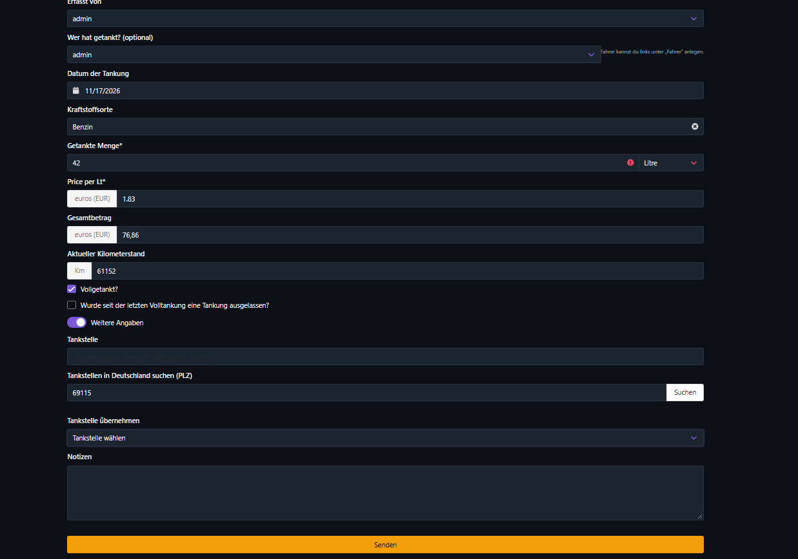

# Hammond Modern 🚗

**Self-Hosted-Fahrzeugverwaltung mit modernisierter Oberfläche, Wartungsplanung und einfacher Datenübernahme aus dem ursprünglichen Hammond.**

Hammond Modern ist ein unabhängiger Community-Fork von [akhilrex/hammond](https://github.com/akhilrex/hammond). Das Projekt ist **nicht offiziell mit dem Originalautor verbunden**.

**Version: v1.1.5** · [Releases](https://github.com/Skoun181/hammond-modern/releases) · [Änderungsverlauf](CHANGELOG-MODERN.md)

> **Teststand:** Die alltäglichen Funktionen und die Migrationsvorschau wurden auf einer privaten Debian-13-LXC-Installation getestet. Der vollständige Import aus einer Original-Datenbank sowie ein umfassender Sicherheits- und Produktionstest sind noch nicht bestätigt.

## Was kann Hammond Modern?

| Bereich | Funktionen |
| --- | --- |
| **Fahrzeuge** | Mehrere Fahrzeuge, Hersteller- und Modellsuche, Kennzeichen, Fahrzeugfreigaben |
| **Tankungen** | Menge, Kraftstoff, Kilometerstand, Preis, Gesamtbetrag, Tankstelle und Fahrer |
| **Tankstellensuche** | Suche per deutscher PLZ mit eigenem Tankerkönig-API-Key |
| **Kosten** | Tankkosten, Werkstattkosten, sonstige Ausgaben, Rechnungen und historische Statistiken |
| **Wartung** | TÜV/HU, Inspektion und Service nach Datum und/oder Kilometerstand planen |
| **Dashboard** | Fahrzeugübersicht, anstehende Wartungen, Kostenübersicht und Verbrauch |
| **Datenmigration** | Original-Hammond-SQLite-Datei prüfen; Fahrzeuge gezielt auswählen und importieren |
| **Oberfläche** | Responsives Layout für PC und Smartphone, Dark-/Light-Mode, deutsche Beschriftungen |

Die Verbrauchsberechnung benötigt mindestens zwei geeignete Volltankungen mit aufsteigenden Kilometerständen. NHTSA-Modellvorschläge decken nicht alle europäischen Fahrzeuge ab; Modelle lassen sich manuell eingeben.

## Was ist neu in v1.1.5?

### 1. Import von Original-Hammond
- Neuer Assistent unter **Datenimport → Hammond-Migration starten**.
- Upload einer konsistenten **`hammond.db`-Sicherung** aus der ursprünglichen Hammond-Installation (max. 50 MB).
- **Vorschau** mit Fahrzeugen, Tankungen und Ausgaben, bevor irgendetwas importiert wird.
- **Automatische Gruppierung identischer Fahrzeugdatensätze**, z. B. mehrfach gespeicherte Fahrzeuge mit gleichem Namen, Kennzeichen, Hersteller und Modell. Zugehörige Tankungen und Ausgaben bleiben erhalten.
- **Checkboxen** zur Auswahl der Fahrzeuge. Ohne Auswahl startet kein Import.
- Erkennung bereits importierter Tankungen/Ausgaben anhand ihrer ursprünglichen IDs, um wiederholte Imports nicht zu duplizieren.
- **Schreibgeschütztes Öffnen** der Quelldatei; Änderungen an der Zieldatenbank laufen in einer Transaktion.

**Achtung:** Übernommen werden derzeit Fahrzeuge, Tankungen und Ausgaben. **Nicht enthalten** sind Benutzerkonten, Passwörter, Freigaben, Anhänge/Rechnungsdateien, alte Quick Entries und Erinnerungen. Fahrerzuordnungen werden nicht übernommen. Der erfolgreiche Abschluss eines Imports auf einem echten Original-Datenbestand wurde noch nicht als getestet bestätigt.

[Ausführliche Migrationsanleitung](docs/MIGRATION-ORIGINAL-HAMMOND.md)

### 2. Wartungscenter und Dashboard
- Wartungen für **HU/TÜV, Inspektion und Service** mit Fälligkeitsdatum und/oder Kilometerstand.
- Übersicht über anstehende Wartungen direkt im Dashboard.
- Überarbeitete Kostenstatistiken mit Zeitraumfilter, Kostendiagrammen und Verbrauchsübersicht.
- Schneller Einstieg **„Tankung hinzufügen“** mit Fahrzeugauswahl.
- Die früheren **Quick Entries** wurden aus der Oberfläche entfernt.

### 3. Design, Mobilgeräte und Zahlenformatierung
- Bessere Fahrzeugdetails und Tabellen auf iPhone und Desktop.
- Dark-Mode-Korrekturen für Tabellen, Hover-Effekt und Auswahllisten.
- Währungen als formatierten Betrag, z. B. **76,63 €**, entsprechend den Einstellungen.
- Literangaben in Statistiken und Fahrzeugdetails auf **eine Nachkommastelle**, z. B. **42,7 Lt**, gerundet.
- Überarbeitete Import-Oberfläche mit besser lesbaren Hinweisen und Auswahlfeldern.

### 4. Noch experimentell
Die **Tankbeleg-Erkennung per Foto/OCR** ist weiterhin nicht zuverlässig. Bitte Tankdaten manuell prüfen und erfassen. Es findet keine automatische Buchung aus einem Foto statt.

Eine automatische Wartungsbenachrichtigung ist derzeit nicht enthalten.

## GitHub-Versionen

| Branch / Tag | Zweck |
| --- | --- |
| [`stable/hammond-modern`](https://github.com/Skoun181/hammond-modern/tree/stable/hammond-modern) | Standardbranch für aktuelle Stable-Installationen |
| [`develop/hammond-modern-next`](https://github.com/Skoun181/hammond-modern/tree/develop/hammond-modern-next) | Weiterentwicklung; Änderungen zunächst hier testen |
| [`v1.1.5`](https://github.com/Skoun181/hammond-modern/releases/tag/v1.1.5) | Versionierter Release-Stand nach Veröffentlichung |
| [`v1.1.0`](https://github.com/Skoun181/hammond-modern/releases/tag/v1.1.0) | Frühere Version |
| [`v1.0.0`](https://github.com/Skoun181/hammond-modern/releases/tag/v1.0.0) | Erste Stable-Version |

Die Branches `stable` und `develop` können sich weiterentwickeln. Für einen **festen** Versionsstand das jeweilige Release-Tag auschecken. Es gibt keinen `master`-Branch mehr.

## Installation mit Docker Compose

Der bisher verwendete und getestete Bereitstellungsweg ist ein **lokaler Docker-Build** auf Linux, insbesondere Debian 13 in Proxmox LXC. Es wird kein fertiges Docker-Hub-Image vorausgesetzt.

### Voraussetzungen
- Docker Engine, Docker Compose Plugin und Git
- Linux-Rechner oder bereits für Docker eingerichteter Proxmox-LXC
- Freier Host-Port **3006** (oder die Compose-Datei entsprechend anpassen)
- Optional: Tankerkönig-API-Key für die Tankstellensuche

### 1. Stable-Version herunterladen

```bash
git clone --branch stable/hammond-modern https://github.com/Skoun181/hammond-modern.git
cd hammond-modern
```

Wenn du exakt **v1.1.5** und keine späteren Stable-Änderungen möchtest:

```bash
git fetch origin --tags
git checkout v1.1.5
```

`git checkout` eines Tags führt zu einem *detached HEAD*, was für eine unveränderliche Release-Installation normal ist.

### 2. Sichere Konfiguration erstellen

```bash
printf 'JWT_SECRET=%s\n' "$(openssl rand -hex 32)" > .env
chmod 600 .env
```

Optional in `.env` ergänzen:

```dotenv
TANKERKOENIG_API_KEY=DEIN_EIGENER_API_KEY
```

**Wichtig:** Den `JWT_SECRET` nach der Inbetriebnahme aufbewahren, bei Updates **nicht verändern** und `.env` nicht auf GitHub hochladen.

### 3. Starten

```bash
mkdir -p data/config data/assets
docker compose -f compose.test.yml up -d --build
docker compose -f compose.test.yml ps
```

Im Browser: **`http://SERVER-IP:3006`**. Beim ersten Start den Administrator einrichten und Währung sowie Entfernungseinheit einstellen.

Die Compose-Datei verwendet folgende Speicherorte:

| Lokaler Pfad | Containerpfad | Inhalt |
| --- | --- | --- |
| `./data/config` | `/config` | Einstellungen und SQLite-Datenbank `hammond.db` |
| `./data/assets` | `/assets` | Dokumente, Bilder und andere Anhänge |

Das lokale Image heißt in der Compose-Datei weiterhin `hammond-modern:next` und der Container `hammond-modern-next`. Dieser technische Name ist **keine Versionsangabe**.

### 4. Vorhandene Installation aktualisieren

**Vor dem Update eine konsistente Sicherung erstellen**, besonders von `data/config`, `data/assets` und `.env`. Bei einer aktiven SQLite-Datenbank die Anwendung dazu anhalten oder eine SQLite-Online-Sicherung verwenden.

```bash
cd /pfad/zu/hammond-modern
git switch stable/hammond-modern
git pull --ff-only origin stable/hammond-modern
docker compose -f compose.test.yml up -d --build
```

**Nicht** `data/config`, `data/assets` oder die bestehende `.env` löschen. Beim Wechsel von einer lokal abweichenden Branch-Historie gegebenenfalls zunächst `git status` und `git branch -vv` prüfen. Keine unüberlegten `git reset --hard`-Befehle auf einem produktiven Checkout ausführen.

Für die Entwicklung stattdessen `git switch develop/hammond-modern-next` und dort aktualisieren. Die Datenbank kann sich durch neue Funktionen verändern – **Stable und Develop deshalb idealerweise nicht gegen dasselbe Datenverzeichnis betreiben**.

## Original-Hammond zu Hammond Modern migrieren

> **Bitte vor der Migration zwei unabhängige Sicherungen anlegen:** eine vom ursprünglichen Hammond und eine vom bestehenden Hammond Modern. Niemals die alte `hammond.db` direkt in das neue Konfigurationsverzeichnis kopieren.

1. **Original-Hammond stoppen** oder eine konsistente SQLite-Online-Sicherung anlegen. Bei laufendem Betrieb können ungeschriebene Daten in `hammond.db-wal` liegen.
2. Die ursprüngliche `hammond.db` auf deinen Computer kopieren.
3. In Hammond Modern **Datenimport → Hammond-Migration starten** öffnen.
4. Die Datenbank über **„Datenbank auswählen“** hochladen und **„Sicherung prüfen“** klicken.
5. Die **Vorschau** prüfen. Identische Quellfahrzeuge werden zusammengefasst; die angezeigten Tankungen und Ausgaben prüfen.
6. Nur die gewünschten Fahrzeuge **per Checkbox** auswählen.
7. Erst nach eigener Kontrolle den Import bestätigen. Anschließend Fahrzeugdaten und Summen stichprobenartig überprüfen.

Doppelte Fahrzeuge werden nur bei passender Identität gruppiert; unterschiedliche Angaben können zu getrennten Fahrzeugen führen. Beim Import werden keine Währungen oder Kilometer/Meilen umgerechnet. Anhänge müssen vorerst separat behandelt werden.

[Mehr zur Migration, Grenzen und Fehlerbehebung](docs/MIGRATION-ORIGINAL-HAMMOND.md)

## Bedienung im Alltag

- **Fahrzeug hinzufügen:** Fahrzeug mit Name, Kennzeichen, Kraftstoffart und weiteren Angaben anlegen.
- **Tankung hinzufügen:** Fahrzeug auswählen; Datum, Kilometerstand, Liter, Preis und Tankstelle eingeben; speichern. Die Fotoerkennung ist optional und experimentell.
- **Ausgabe hinzufügen:** Werkstatt- oder sonstige Kosten samt optionaler Rechnung erfassen.
- **Wartungscenter:** z. B. „TÜV“ oder „Ölwechsel“ mit Datum bzw. Kilometerstand anlegen und später erledigt markieren.
- **Dashboard:** Kostenzeitraum auswählen und Ausgaben sowie anstehende Wartungen ansehen.
- **Design wechseln:** Dark-/Light-Mode über die Navigation umschalten.

## Fehlerdiagnose

```bash
docker compose -f compose.test.yml ps
docker compose -f compose.test.yml logs --tail=100
docker compose -f compose.test.yml restart
```

Beim Import nur eine **echte SQLite-`hammond.db`-Datei** verwenden; kein ZIP und keine Kopie der Ziel-Datenbank. Die maximale Dateigröße beträgt **50 MB**. Falls die Prüfung scheitert, zuerst prüfen, ob die Originaldatenbank konsistent gesichert wurde.

Für den Fernzugriff **HTTPS über Reverse Proxy oder VPN** verwenden und den HTTP-Port nicht ungeschützt im Internet veröffentlichen.

## Sicherheit und Einschränkungen

- Hammond Modern enthält ältere Abhängigkeiten aus dem Originalprojekt; ein vollständiges Sicherheits-Audit fehlt.
- Keine garantierte Kompatibilität mit allen sehr alten oder individuell veränderten Hammond-Datenbanken.
- Die Migrations-*Vorschau* einschließlich Duplikatgruppierung wurde praktisch bestätigt. Ein kompletter produktiver Datenimport mit Anhängen oder mehreren Nutzern ist **noch nicht umfassend validiert**.
- Die Tankbeleg-OCR-Erkennung bleibt experimentell.
- Oberfläche und Dokumentation sind teilweise noch nicht vollständig übersetzt.
- Synology-/DSM-Betrieb ist dokumentiert, aber für diese Version nicht als getestet bestätigt.

## Screenshots

### Dashboard


### Tankung erfassen


### Tankstellensuche


## Weitere Dokumentation

- [Migration vom Original-Hammond](docs/MIGRATION-ORIGINAL-HAMMOND.md)
- [Versionshistorie](CHANGELOG-MODERN.md)
- [Testnotizen: Fahrzeug- und Tankstellensuche](docs/FAHRZEUG-TANKSTELLEN-TEST.md)
- [Weitere Funktionen](docs/HAMMOND-MODERN-NEUE-FUNKTIONEN.md)
- [Synology-Installation (separat prüfen)](docs/SYNOLOGY.md)

## Herkunft und Lizenz

Hammond Modern basiert auf [akhilrex/hammond](https://github.com/akhilrex/hammond) von Akhil Gupta. Vielen Dank an den ursprünglichen Autor und die bisherigen Mitwirkenden. Das Repository steht unter **[AGPL-3.0](LICENSE)**; ursprüngliche Lizenz- und Copyright-Hinweise bleiben erhalten.

[Repository](https://github.com/Skoun181/hammond-modern) · [Issues](https://github.com/Skoun181/hammond-modern/issues) · [Releases](https://github.com/Skoun181/hammond-modern/releases)
